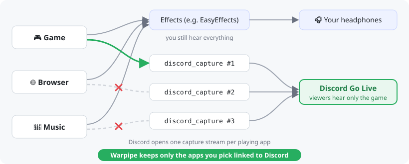
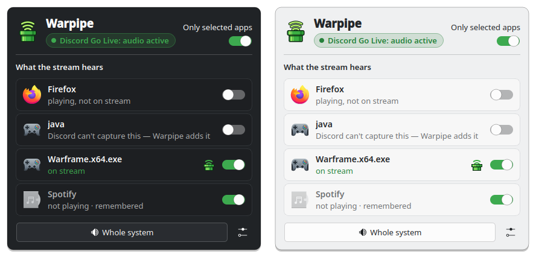
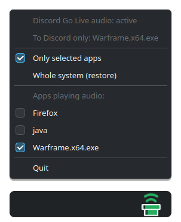

<p align="center">
  
</p>

<h1 align="center">Warpipe</h1>

<p align="center"><b>Per-app PipeWire audio for Discord Go Live on Linux.</b><br>
Stream your game — not your YouTube tab, music or notifications.</p>

---

## Why

On Linux (Wayland) the official Discord client can only share **all desktop audio or none** when you
stream with Go Live. Share a game and your viewers also hear everything else that plays.
Discord is working on per-app audio sharing via xdg-desktop-portal, but it is not there yet.

Warpipe fills the gap today: pick the apps your viewers should hear, everything else stays private.

## How it works

<p align="center"></p>

The official Discord client captures Go Live audio through `pipewire-pulse`: it opens one record
stream per playing application (`discord_capture`, media name `game capture`), and WirePlumber links
each app's output to it. Warpipe rewires exactly those links:

- only the apps you pick stay linked to Discord's capture streams — you still hear everything;
- the choice is remembered and applied automatically whenever Go Live with audio starts;
- apps Discord never captures on its own (native PipeWire apps without a PID, e.g. Minecraft/OpenAL)
  can be routed into the stream too;
- audio is taken **before** your effects (e.g. EasyEffects), just like Discord does it;
- the original links are snapshotted and restored on exit or with **Whole system**;
- Discord streams its own notification sounds on Linux (they come from the Discord app itself, not
  from its voice engine, so Discord doesn't filter them out); Warpipe keeps them off the stream by
  default, also in **Whole system** mode — only those links are cut, nothing else changes. The menu
  item **Keep Discord's own sounds off the stream** or `warpipe --discord-sounds on` lets them through;
- microphones, devices, sinks and WirePlumber configuration are never touched.

## Tray

**Left click: window, right click: menu.** Click the green pipe in the system tray, switch on the apps
that should be heard on stream (that turns on **Only selected apps**), and watch what the stream
hears, live. **Whole system** gives you Discord's normal behaviour back. Escape or another left
click closes the window; its menu button has the language, start at login and Quit.

<p align="center"></p>

The tray icon shows the state at a glance: full sound waves while Warpipe is shaping a Go Live
stream, faded waves while it waits for one, grey in **Whole system** mode. The right-click menu has
the same switches:

<p align="center"></p>

## Install

Requirements: Linux with PipeWire + WirePlumber, Python 3, PySide6 (`python3-pyside6` on Fedora),
`pw-dump` / `pw-link`, and the official Discord desktop client (Flatpak or native).

```sh
git clone https://github.com/Gawson/warpipe.git
cd warpipe
./install.sh              # user-level, into ~/.local (no root)
./install.sh --autostart  # …and start Warpipe at login
```

Then start **Warpipe** from your application menu, or run `warpipe`.
Uninstall with `./uninstall.sh` (add `--purge` to also remove settings). A running Warpipe restores
Discord's original links when it exits.

## Command line

| Command | What it does |
|---|---|
| `warpipe` | tray icon (default in a graphical session) |
| `warpipe --list [--json]` | Discord capture streams and apps that play audio |
| `warpipe --apply APP…` | one-shot: only these apps go to the stream |
| `warpipe --watch` | keep enforcing without a tray icon (Ctrl+C restores) |
| `warpipe --restore` | restore the original links (whole system) |
| `warpipe --status` / `--toggle APP` / `--system` | talk to the running instance |
| `warpipe --discord-sounds on\|off` | let Discord's own sounds (dings) onto the stream, or keep them off (default) |
| `warpipe --dry-run …` | show what would change |
| `warpipe --dump FILE` | anonymized `pw-dump` for bug reports (no titles, user or host names) |

Settings live in `~/.config/warpipe/config.json` (selected apps, enforcement on start, language:
`auto`, `en` or `pl`, `mute_discord_own_sounds`).

## Extras: Stream Deck (OpenDeck)

Optional plugin for [OpenDeck](https://github.com/nekename/OpenDeck): one key per app
(grey when not playing, glowing when on stream, press to toggle) and a **Whole system** key.
Build it with `opendeck-plugin/build.sh` and use **Plugins → Install from file** in OpenDeck.

Testing status: so far the plugin has only been tested against a fake OpenDeck harness
(`tests/fake_opendeck.py`) that implements the Stream Deck SDK protocol the way OpenDeck 2.14 does —
not yet with a real OpenDeck installation or real Stream Deck hardware.

<p align="center"></p>

## Tips

- **Go Live stops when you switch back to a fullscreen game?** Share the whole screen, not the game
  window. Many fullscreen games set up their window again when you Alt+Tab back in; Discord then
  loses the shared window and ends the stream. A shared screen keeps going, and Warpipe's audio
  choice is the same either way. Viewers see everything on that screen, so keep Discord on another
  monitor.
- **What is Discord capturing right now?** `warpipe --list` shows Discord's capture streams and the
  apps playing audio.

## Limitations

- Linux + PipeWire + the **official** Discord client. Vesktop users already have a per-app picker (venmic).
- When a new, unselected app starts playing, WirePlumber links it immediately; Warpipe cuts it within
  a fraction of a second, so a very short blip can reach the stream.
- PID-less apps (e.g. Minecraft) can only join the stream while Discord has at least one capture
  stream open (i.e. some other app with a PID is playing).
- Discord's own sounds are only kept off while Warpipe runs; without it, new dings reach the stream
  again (Warpipe cuts links, it never changes PipeWire or Discord settings).
- Tested on Fedora 45, KDE Plasma 6 (Wayland), PipeWire 1.6, WirePlumber 0.5.

## Development

```sh
python3 -m unittest discover -s tests   # unit tests, no PipeWire needed
bash tests/live_pipewire.sh             # live test: creates its own null sink and silent
bash tests/live_plugin.sh               #   test streams, never touches your devices, cleans up
```

The unit tests include two anonymized `pw-dump` snapshots of a real KDE/Wayland desktop
(Go Live without and with audio). Icons are original vector drawings (`data/icons/tools/`).

## Not affiliated

Warpipe is an independent project. It is not affiliated with or endorsed by Discord, the PipeWire
project, Elgato or Nintendo.

## License

[MIT](LICENSE) © 2026 Tomasz Gawlik
